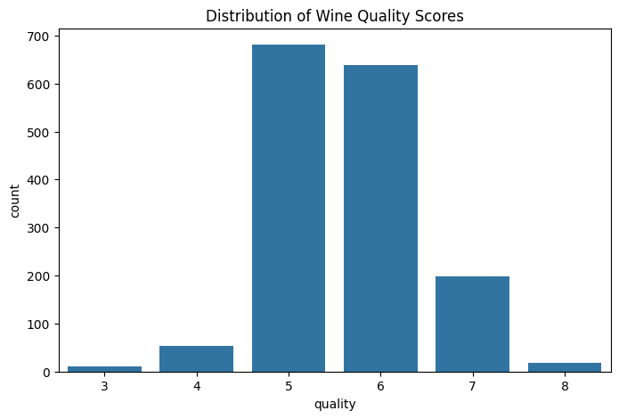
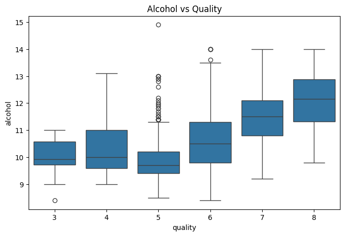
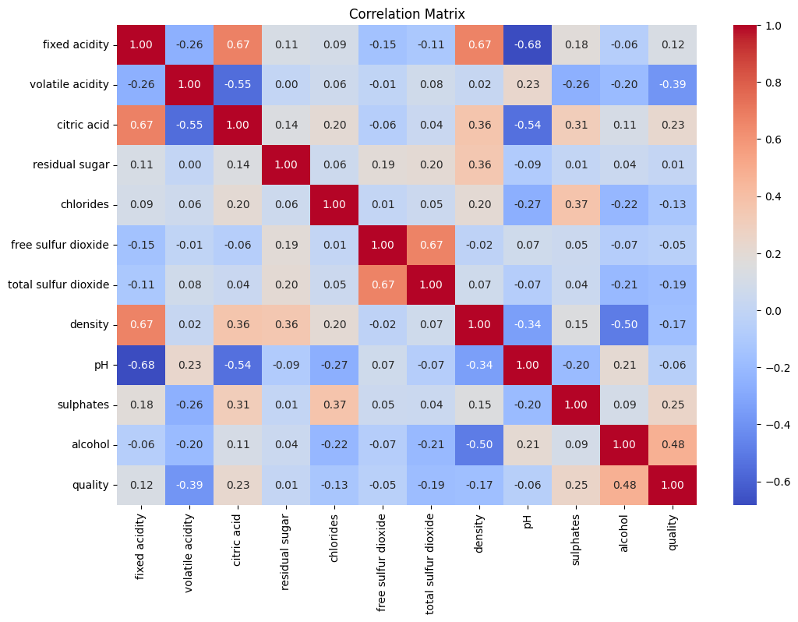

# Red Wine Quality: Exploratory Data Analysis

An exploratory data analysis in Python of 1,599 Portuguese red wines. It looks at how quality is distributed, which chemical properties relate to quality, and where the data has skew and outliers. This is the groundwork for building a model.

**Tech:** Python · pandas · matplotlib · seaborn · Jupyter

**[Open the notebook →](wine_quality_eda.ipynb)**

---

## Key findings

| # | Finding | What it means for a model |
|---|---|---|
| 1 | Most wines score 5–6. Very few score very low or very high. | The classes are imbalanced if quality is used for classification. |
| 2 | **Alcohol** has the strongest positive relationship with quality (r = 0.48). | Probably the most important feature. |
| 3 | **Volatile acidity** has the strongest negative relationship (r = −0.39). | A strong candidate feature. |
| 4 | Sulphates (r = 0.25) and citric acid (r = 0.23) have a weak to moderate positive relationship. | Useful, but less important. |
| 5 | Several features are skewed with outliers, for example chlorides, residual sugar and sulphates. | Scaling helps, and tree-based models are more robust to it than linear models. |

 



## What the notebook covers

1. Loading the data with `kagglehub`.
2. Structure, data types and missing values (there are none).
3. Summary statistics.
4. Distribution of the target (quality).
5. Histograms of every feature.
6. Correlation heatmap and correlation with the target.
7. Boxplots of alcohol against quality, and an outlier check across all features.

## Running it

```bash
pip install -r requirements.txt
jupyter notebook wine_quality_eda.ipynb
```

The dataset is downloaded automatically from Kaggle the first time the notebook runs.

## Next step

Build a model that predicts quality from these features, for example a random forest compared with a logistic regression baseline, and use the findings above to guide feature choice and preprocessing.

## Dataset

P. Cortez, A. Cerdeira, F. Almeida, T. Matos and J. Reis. *Modeling wine preferences by data mining from physicochemical properties.* Decision Support Systems, 2009. Available on [Kaggle](https://www.kaggle.com/datasets/uciml/red-wine-quality-cortez-et-al-2009) and the [UCI Machine Learning Repository](https://archive.ics.uci.edu/dataset/186/wine+quality).
